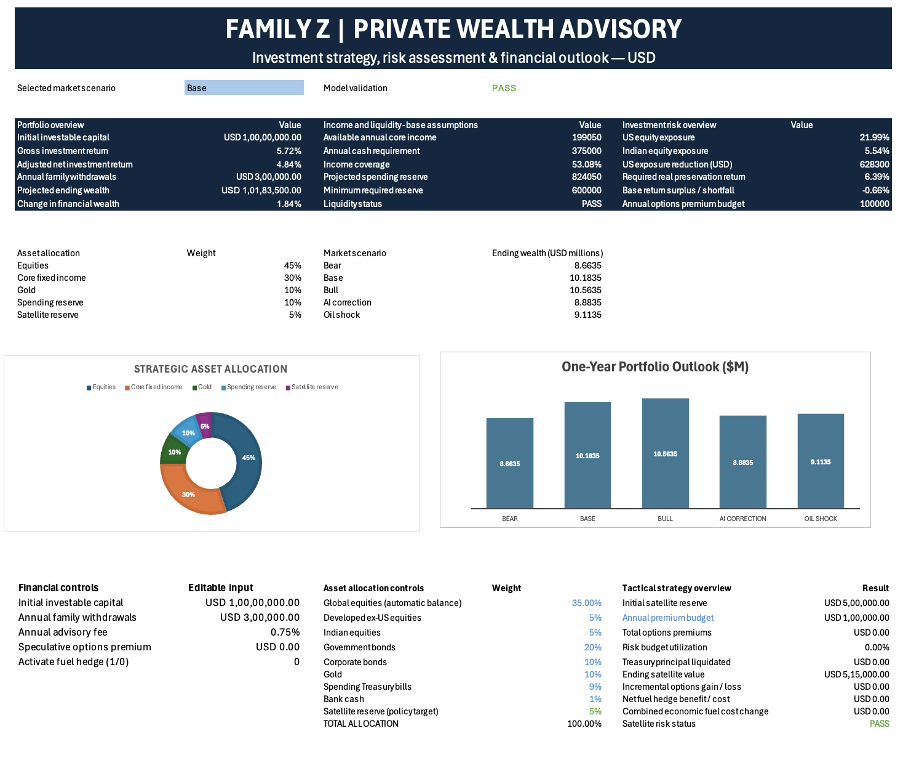

# Multi-Asset Portfolio Construction & Private Wealth Advisory

### Family Z | Independent $10 Million Wealth Management Case Study

**Dubai, UAE · Portfolio Construction · Investment Research · Financial Planning · Risk Management**

[Download the Interactive Excel Financial Model](Family_Z_Wealth_Advisory.xlsx) | [View Executive Dashboard](#executive-dashboard)

---

## Executive Summary — What I Built

Imagine a wealthy family in Dubai that owns a logistics company, several international properties and has another $10 million available to invest.

The family needs $300,000 every year to support its lifestyle. It wants its wealth to grow but also needs protection against economic downturns, inflation and unnecessary investment risks.

Its logistics business introduces another complication: rising fuel prices, declining international trade and economic recessions could damage the family's existing wealth.

I designed a diversified investment portfolio using global equities, Indian equities, government bonds, corporate bonds, gold and short-term US Treasury bills.

I then built an interactive Excel financial model to answer five practical questions:

- How should the family invest its $10 million?
- What happens to its wealth during a recession, AI market correction or oil price shock?
- Can investment income cover the family's annual expenses?
- Can financial derivatives partially protect the family against rising fuel costs?
- Is the portfolio growing fast enough to preserve purchasing power after spending, investment fees and inflation?

The project identified an important trade-off: reducing dependence on US technology stocks through international diversification introduces different economic risks, particularly energy-price exposure through Indian equities.

To address part of this overlapping risk, I modeled an optional fuel-price hedge funded through a separate tactical investment reserve.

The final analysis found that the proposed portfolio maintains sufficient modeled liquidity but falls short of its inflation-adjusted capital preservation objective in the base case.

### Project at a Glance

| Key Financial Finding | Result |
|---|---:|
| Financial assets modeled | $10,000,000 |
| Annual household expenditure | $300,000 |
| Investment allocation lines | 11 |
| Economic scenarios evaluated | 5 |
| Reduction in US equity exposure | $628,300 |
| Relative reduction in US equity exposure | 22.22% |
| Initial household spending coverage | 3.33 years |
| Estimated annual investment income | $214,050 |
| Annual cash requirement covered by core income | 53.08% |
| Base-case net investment return | 4.835% |
| Base-case ending financial wealth | $10,183,500 |
| Real capital preservation return shortfall | 66.5 basis points |
| Illustrative net fuel hedge benefit | $30,000 |

**Executive conclusion:** The portfolio reduces US equity concentration, maintains a dedicated liquidity reserve and provides controlled flexibility for tactical investments. However, investment costs, expenditure and inflation create a purchasing-power shortfall that requires further financial planning.

---

## Executive Dashboard

[Download the Interactive Excel Workbook](Family_Z_Wealth_Advisory.xlsx)

The dashboard allows users to modify investment capital, annual withdrawals, advisory fees, strategic asset allocations, market scenarios and tactical investment assumptions.

Financial calculations and charts automatically update through four interconnected Excel worksheets.

*The dashboard shows the default $10 million portfolio with the Base scenario selected and no active options positions. Family Z is fictional, and all scenario outcomes are hypothetical.*
